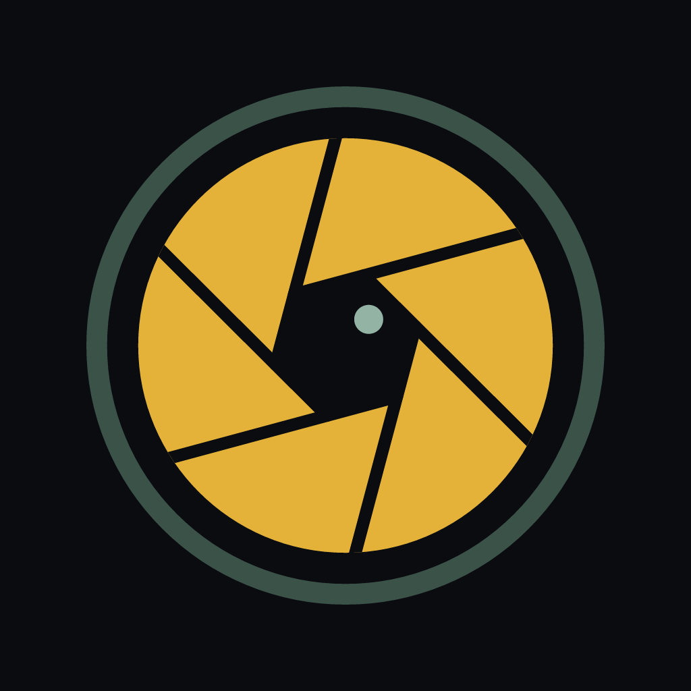

<p align="center"></p>

<p align="center"><a href="README.md">English</a> · <b>Français</b></p>

# Déclic

**Apprendre la photographie, simplement.** Application libre et gratuite :
sans compte, sans publicité, sans pistage. Tout reste sur votre téléphone.

- 📖 Des fiches en deux versions : **Simple** (mots du quotidien, exemples dessinés) et **Complète** (simulateurs).
- 🎯 Des défis à faire avec votre appareil ou votre téléphone, et un carnet photo pour suivre vos progrès.
- 🆘 « SOS Photo ratée » : flou, trop sombre, trop clair, grain… la solution en un geste.
- 🏅 Rangs C → S, XP, avatar à personnaliser, succès (dont des secrets).
- 🤝 Pour photographes et modèles (18 ans et plus) : les règles du TFP, une charte et le **Contrat-Minute**,
  un accord écrit signé à deux et exporté en PDF.

## Installer (Android)

1. Ouvrez la page **[Releases](../../releases/latest)** depuis votre téléphone Android.
2. Téléchargez le fichier `.apk` de la dernière version.
3. Ouvrez-le. Android demande d'autoriser l'installation depuis cette source : acceptez.
4. Si Play Protect affiche un avertissement, touchez « Installer quand même » (normal hors Play Store).

**Mises à jour :** installez la nouvelle version par-dessus l'ancienne, votre progression est conservée.
Pour être prévenu automatiquement, utilisez l'app libre [Obtainium](https://github.com/ImranR98/Obtainium)
avec l'adresse de ce dépôt.

**iPhone :** pas encore disponible (une version web installable est envisagée).

**Langues :** français et anglais, selon la langue du téléphone.

## Vie privée

Aucune donnée n'est envoyée à l'éditeur ni à un tiers : progression, photos, accords et profil restent
dans la mémoire de l'application. Voir la politique de confidentialité dans l'app (Profil > Mes données).

## Licence

Code sous licence [MIT](LICENSE). Polices Playfair Display et Inter sous licence SIL Open Font License 1.1.

---

## Pour les développeurs

Expo SDK 58 · React Native 0.88 · TypeScript · Expo Router

## Lancer

```bash
npm install
npm start          # puis scanner le QR code avec Expo Go
npm run typecheck
```

## Architecture

```
src/
├─ app/                     # Routes (Expo Router) — 1 fichier = 1 écran
│  ├─ _layout.tsx           # Stack, thème clair/sombre, ProgressProvider
│  ├─ index.tsx             # Sommaire par sections
│  ├─ fiche/[id].tsx        # Écran unique pour toutes les fiches (rendu par blocs)
│  └─ defis.tsx             # Défis photo (?focus=<id> ouvre un défi) + validation locale
├─ components/
│  ├─ AppText, Callout, ExposureScale, SheetCard, SituationCard
│  ├─ sheet/                # Un composant par type de bloc
│  │  ├─ SheetBlock.tsx     # Aiguillage bloc → composant (switch exhaustif)
│  │  ├─ SettingsCard.tsx, StepsList.tsx, RelatedLinks.tsx
│  └─ simulator/
│     ├─ ExposureSimulator.tsx  # Triangle d'exposition (focus, preset, light)
│     ├─ SimulatedScene.tsx     # « photo » en View : flou, traînée, grain, luminosité
│     ├─ MeteringDemo.tsx       # Cellule 18 % et correction +/−
│     └─ StopSlider.tsx
├─ content/                 # Contenu pédagogique, séparé du code
│  ├─ types.ts              # Sheet, Block, Challenge, Problem, Section, ContentPack
│  ├─ locales/fr/           # Contenu français (langue source)
│  │  ├─ sections.ts, challenges.ts, troubleshooting.ts (SOS)
│  │  ├─ sheets/            # fundamentals.ts, composition.ts, situations.ts
│  │  └─ index.ts           # Assemble le ContentPack français
│  └─ index.ts              # Catalogue par langue + validation en dev
├─ i18n/                    # Textes de l'interface
│  ├─ fr.ts                 # Source : sa forme définit le type UiStrings
│  ├─ en.ts                 # Anglais (doit avoir exactement les mêmes clés)
│  ├─ locales.ts            # Langues d'interface déclarées
│  └─ index.tsx             # I18nProvider + useI18n() → { locale, t, catalog }
├─ lib/exposure.ts          # Calculs d'exposition (stops)
├─ storage/progress.tsx     # AsyncStorage + contexte React
└─ theme/                   # Tokens (couleurs, espacements, typo) + useTheme()
```

## Ajouter du contenu

- **Une fiche** : un objet `Sheet` dans le fichier de sa section (`src/content/sheets/`).
  Elle apparaît automatiquement dans le sommaire, sans toucher aux écrans.
- **Un bloc** : `text`, `tip`, `simulator`, `metering`, `settings`, `steps`, `related`, `comingSoon`.
- **Un nouveau type de bloc** : l'ajouter à `Block` (`types.ts`) puis dans `SheetBlock.tsx`
  (le compilateur signale l'oubli).
- **Un défi** : une entrée dans `src/content/challenges.ts`. Ne jamais renommer un `id` publié :
  c'est la clé de la progression enregistrée.
- En développement, les liens vers des fiches ou défis inexistants s'affichent en avertissement.

## Identité visuelle

- **Chambre Noire** (sombre, `#0A0C10`, cartes ardoise) et **Papier Studio** (clair, `#F4F4F2`), selon le téléphone.
- Olive `#3B5249` pour la structure, ambre `#E5B239` pour les accents, brique `#C2593F` pour le SOS.
- Chaque couleur existe en **remplissage** (`primary`, `accent`, `danger` + `onXxx`) et en **encre**
  lisible sur le fond (`primaryInk`, `accentInk`, `dangerInk`) : voir `src/theme/tokens.ts`.
- Titres en **Playfair Display** (serif), textes en **Inter** (sans-serif), chargés au démarrage.

## Progression

| Rang | XP | Titre |
| --- | --- | --- |
| C | 0 – 99 | Débutant · Apprenti |
| B | 100 – 299 | Amateur Éclairé |
| A | 300 – 599 | Photographe Confirmé |
| S | 600 + | Maître de l'Optique |

Gains : fiche lue jusqu'au bout **+10**, défi réussi **+20**, solution SOS consultée **+15**.
Chaque élément ne rapporte qu'une fois. Le stockage (`src/storage/progress.tsx`, clé
`@declic/progress/v2`) garde *ce qui a été fait* avec sa date, et l'XP en est recalculée :
le barème (`src/lib/ranks.ts`) peut changer sans migration. Décocher un défi retire ses 20 XP.

## Paliers et test de validation

| Palier | Contenu | S'ouvre… |
| --- | --- | --- |
| Fondamental | 4 fiches, 3 défis (100 XP) | dès le départ |
| Avancé | 8 fiches, 6 défis (200 XP) | rang B, **ou** toutes les fiches fondamentales lues, **ou** test Fondamental réussi |
| Expert | 5 fiches, 6 défis (170 XP) | rang A ou S, **ou** test Avancé réussi |

Chaque fiche et chaque défi porte un champ `tier`. Règles dans `src/lib/tiers.ts`.

**Test « Valider ses acquis »** (`/quiz/[tier]`) : 15 questions tirées d'une banque de 20 par palier
(`content/locales/fr/quiz.ts`), propositions mélangées, réponse commentée. 12 / 15 (80 %) pour réussir.
Réussite : palier suivant ouvert, et les fiches / défis non faits du palier testé sont **crédités**
(`credited` dans la progression) : leur XP est acquise, sans les marquer comme lus ou photographiés.
Les faire ensuite ne rapporte rien de plus.

XP maximale : 470 (contenu) + 75 (SOS) + 130 (jalons et secrets) = 675, le rang S (600) est donc atteignable.

## Carnet, avatar et succès

- **Carnet de bord** (`src/storage/journal.tsx`, écran `/carnet`) : chaque défi a un bouton
  « Ajouter une photo » (appareil photo ou galerie, `expo-image-picker`). La photo est copiée
  dans le dossier privé de l'app (`<documents>/carnet/`, `expo-file-system`) et valide le défi.
  Rien n'est envoyé en ligne. Retirer une photo ne dé-valide pas le défi.
- **Avatar** (`src/lib/avatar.ts`, dessin SVG dans `components/avatar/Avatar.tsx`, écran `/avatar`) :
  6 emplacements (tenue, chapeau, lunettes, appareil, cheveux, teint), 23 pièces.
  Les pièces se **débloquent** par paliers (rang, défis, fiches, SOS, photos, succès) au lieu
  de s'acheter : dépenser de l'XP ferait redescendre de rang.
- **Succès** (`src/lib/achievements.ts`, écran `/succes`) : un badge par défi et par rang (générés),
  4 jalons visibles et 7 secrets. Les secrets reposent sur des compteurs (`COUNTERS`) :
  taps sur le titre de l'accueil, heure d'ouverture, crans de simulateur, expositions retrouvées,
  visites du SOS, nombre de photos. Un succès obtenu le reste.

## Traduction

Deux couches, séparées :

1. **Interface** (`src/i18n/`) : boutons, titres, messages des simulateurs.
   `en.ts` est typé `UiStrings` : une clé manquante empêche la compilation.
   Les textes variables sont des fonctions (`challengesProgress(done, total)`) pour
   respecter l'ordre des mots et les pluriels de chaque langue.
2. **Contenu** (`src/content/locales/<code>/`) : fiches, défis, SOS.

Dans les composants : `const { t, catalog } = useI18n();`, jamais de texte en dur.

**Ajouter une langue** (ex. espagnol) :
1. Copier `src/i18n/en.ts` en `es.ts`, traduire, l'ajouter dans `src/i18n/locales.ts`.
2. Copier `src/content/locales/fr/` en `es/`, traduire **sans toucher aux `id`**
   (ils servent d'URL et de clé de progression).
3. Enregistrer le pack dans `contentPacks` (`src/content/index.ts`).

La langue du téléphone est choisie seulement si l'interface **et** le contenu existent ;
sinon l'app reste en français. En développement, un avertissement liste les `id`
manquants ou en trop par rapport au français.

État actuel : **français et anglais complets** (interface + contenu, `content/locales/{fr,en}/`).
L'espace collaborations a ses textes par langue dans `content/locales/<langue>/collab.ts`
(accessibles via `useCollab()`), avec une structure commune dans `content/collabModel.ts`.

## Choix techniques

- **Styles natifs + tokens** plutôt que NativeWind : zéro configuration Babel/Metro,
  pas de dépendance à suivre à chaque version du SDK. NativeWind reste ajoutable plus tard.
- **Aucune dépendance graphique native** (SVG, Skia) : le simulateur tourne dans Expo Go.

## Licence

MIT
