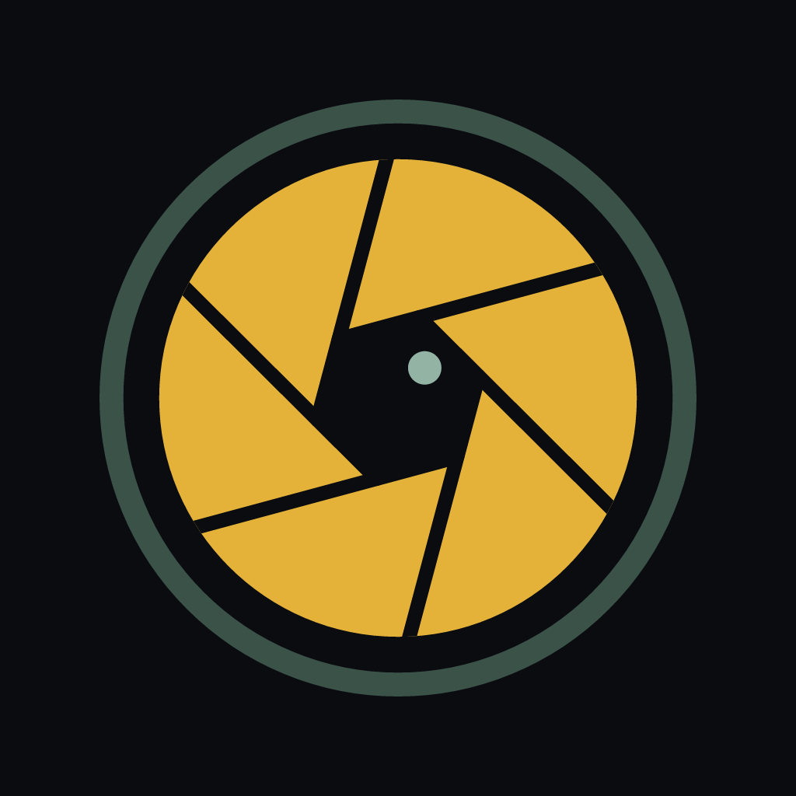

<p align="center"></p>

<p align="center"><b>English</b> · <a href="README.fr.md">Français</a></p>

# Déclic

**Learn photography, simply.** A free and open-source app:
no account, no ads, no tracking. Everything stays on your phone.

> 🇬🇧 🇫🇷 Available **in English and French**: the app follows your phone’s language.
> Translations into other languages are welcome!

- 📖 Lessons in two versions: **Simple** (everyday words, illustrated examples) and **Full** (interactive simulators).
- 🎯 Real-life photo challenges to do with your camera or phone, and a photo journal to track your progress.
- 🆘 "Photo SOS": blurry, too dark, too bright, grainy… the fix in one tap.
- 🏅 Ranks C → S, XP, a customisable avatar, achievements (including secret ones).
- 🤝 For photographers and models (18+): TFP ground rules, a charter and the **Quick Agreement**,
  a written agreement signed by both people and exported as a PDF.

## Install (Android)

1. On your Android phone, open the **[Releases](../../releases/latest)** page.
2. Download the `.apk` file of the latest version.
3. Open it. Android asks you to allow installs from this source: accept.
4. If Play Protect shows a warning, tap "Install anyway" (normal outside the Play Store).

**Updates:** install the new version over the old one; your progress is kept.
To be notified automatically, use the free app [Obtainium](https://github.com/ImranR98/Obtainium)
with this repository's address.

**iPhone:** not available yet (an installable web version is being considered).

## Privacy

No data is sent to the publisher or to any third party: progress, photos, agreements and profile stay
in the app's private storage. Android automatic backup is disabled.
Read the [privacy policy](docs/privacy.md) ([français](docs/confidentialite.md)).

## Licence

Code under the [MIT](LICENSE) licence. Playfair Display and Inter fonts under the SIL Open Font License 1.1.

## For developers

Expo SDK 58 · React Native 0.88 · TypeScript · Expo Router

```bash
npm install
npm start          # then scan the QR code with Expo Go
npm run typecheck
```

Build an installable APK with EAS:

```bash
npx eas-cli@latest build -p android --profile preview
```

The detailed developer documentation (architecture, content model, translations, progression system)
is currently in French: see [README.fr.md](README.fr.md#pour-les-développeurs).
The roadmap for the community features is in [docs/phase2-communaute.md](docs/phase2-communaute.md).
